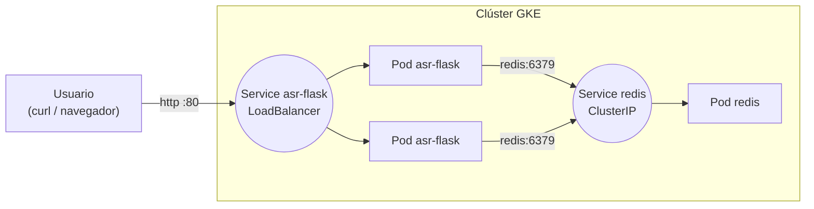

### Introducción
El objetivo de esta práctica es introducir Google Kubernetes Engine (GKE),
un servicio de Kubernetes gestionado y seguro para el despliegue, gestión y
(auto)escalado de aplicaciones contenerizadas usando la infraestructura de
GCP. Para ello vamos a crear un cluster GKE, que consiste en un conjunto de VMs
(instancias de Google Compute Engine), y desplegaremos en él la **misma aplicación
Flask + Redis** de la [práctica 4](../04-virtual-machines/02.%20flask-redis/README.md),
pero esta vez sobre Kubernetes en lugar de sobre dos VMs.

Si comparamos con la práctica 4:

| Práctica 4 (VMs)                                        | Esta práctica (Kubernetes)                                   |
|---------------------------------------------------------|--------------------------------------------------------------|
| Una VM con Container-Optimized OS para Redis            | Un `Deployment` de Redis                                     |
| Una VM con Container-Optimized OS para la app           | Un `Deployment` de la app (con 2 réplicas)                   |
| La app encuentra a Redis por su **IP interna**          | La app encuentra a Redis por el **nombre de su Service** (`redis`) |
| Regla de firewall para que solo la app llegue a Redis   | `Service` de tipo `ClusterIP`: Redis no sale del clúster     |
| Regla de firewall + IP pública de la VM para la app     | `Service` de tipo `LoadBalancer`: balanceador con IP pública |

El resultado final será este:



### Ficheros de la práctica

- [app/](app): el código de la aplicación, el mismo que en la práctica 4
  ([app.py](app/app.py), [requirements.txt](app/requirements.txt),
  [Dockerfile](app/Dockerfile) y [entrypoint.sh](app/entrypoint.sh)), con un pequeño
  arreglo en `/reset` para que funcione también sin cuerpo JSON.
- [k8s/](k8s): los manifiestos de Kubernetes:
    - [redis-deployment.yaml](k8s/redis-deployment.yaml) y
      [redis-service.yaml](k8s/redis-service.yaml): Redis, expuesto solo dentro del
      clúster con un Service `ClusterIP`.
    - [app-deployment.yaml](k8s/app-deployment.yaml) y
      [app-service.yaml](k8s/app-service.yaml): la app Flask, expuesta a internet con
      un Service `LoadBalancer`.
- [config.ini](config.ini) y [clean.sh](clean.sh): script para borrar todos los
  recursos al terminar.

### Previo

- Tener Docker instalado (igual que en la práctica 4) y el proyecto de GCP
  seleccionado.
- Todos los comandos se lanzan **desde esta carpeta** (`07-k8s-init`).

### 1. Configurar la región, la zona y el nombre del clúster

```shell
gcloud config set compute/region europe-southwest1
gcloud config set compute/zone europe-southwest1-b
export CLUSTER_NAME=k8s-flask-redis
```

### 2. Creación del cluster GKE

Habilitamos la API de GKE (solo hace falta la primera vez) y creamos el clúster.
Éste constará de un plano de control (gestionado por Google) y varias VMs que
ejecutarán nuestros contenedores, llamadas en este contexto **nodos**:

```shell
gcloud services enable container.googleapis.com

gcloud container clusters create $CLUSTER_NAME \
--enable-master-authorized-networks \
--enable-ip-alias \
--machine-type=e2-medium \
--num-nodes=1 \
--disk-size 20 \
--master-authorized-networks "$(curl -s ifconfig.me)/32"
```
La creación del clúster podrá llevar varios minutos.

#### Explicación:
- `CLUSTER_NAME`: el nombre que le quieras dar al cluster. La zona es la que hemos
  configurado por defecto en el paso anterior (`europe-southwest1-b`).
- `--enable-ip-alias`: opción para habilitar alias de IP (redes VPC-native).
- `--machine-type=e2-medium`: tipo de VM de cada nodo. Con un nodo `e2-medium` hay
  hueco de sobra para Redis, dos réplicas de la app y los componentes del sistema.
- `--num-nodes=1`: sin este flag GKE crea 3 nodos por defecto. Un único nodo es suficiente para este ejemplo (sacrifica la alta disponibilidad, que no necesitamos aquí).
- `--disk-size DISK_SIZE`: tamaño del disco para cada nodo en GB.
- `--master-authorized-networks "$(curl -s ifconfig.me)/32"`: restringe el acceso al API server solo a tu IP pública.

⚠️ Si tu IP pública cambia (otra red wifi, Cloud Shell reiniciado...), `kubectl` dejará
de poder conectar con el clúster. Puedes volver a autorizar tu IP actual con:

```shell
gcloud container clusters update $CLUSTER_NAME \
--enable-master-authorized-networks \
--master-authorized-networks "$(curl -s ifconfig.me)/32"
```

### 3. Conectar `kubectl` con el clúster

⚠️ Para la gestión del cluster necesitaremos tener instalado `kubectl` (the Kubernetes command-line tool).
Puedes encontrar el instalador [aquí](https://kubernetes.io/docs/tasks/tools/), o instalarlo directamente vía `gcloud`
(en Cloud Shell ya viene instalado):

```shell
gcloud components install kubectl gke-gcloud-auth-plugin
kubectl version --client
```

> Si instalaste `gcloud` con `apt` (Ubuntu/WSL2), `gcloud components` no funciona:
> instala los paquetes con `sudo apt-get install kubectl google-cloud-cli-gke-gcloud-auth-plugin`.

Obtenemos las credenciales del clúster (se guardan en `~/.kube/config`) y
comprobamos que vemos el nodo:

```shell
gcloud container clusters get-credentials $CLUSTER_NAME
kubectl get nodes
```

### 4. Construir y publicar la imagen de la app en Artifact Registry

Igual que en la práctica 4, la imagen de la app tiene que estar en un registry desde
el que el clúster pueda descargarla. Creamos el repositorio (si lo borraste al final
de la práctica 4; si ya existe, el `create` dará un error que puedes ignorar):

```shell
gcloud services enable artifactregistry.googleapis.com
gcloud artifacts repositories create asr-registry \
    --repository-format=docker \
    --location=europe-southwest1 \
    --description="Repo docker practicas ASR"
gcloud auth configure-docker europe-southwest1-docker.pkg.dev --quiet
```

Los nodos de GKE descargan las imágenes con la cuenta de servicio por defecto de
Compute Engine, así que le damos permiso de lectura sobre Artifact Registry (solo
hace falta una vez por proyecto, igual que en la práctica 4):

```shell
PROJECT_NUMBER=$(gcloud projects describe $(gcloud config get-value project) --format='value(projectNumber)')
gcloud projects add-iam-policy-binding $(gcloud config get-value project) \
    --member="serviceAccount:${PROJECT_NUMBER}-compute@developer.gserviceaccount.com" \
    --role="roles/artifactregistry.reader"
```

Construimos y subimos la imagen. Fíjate en que, a diferencia de la práctica 4,
**no pasamos la IP de Redis** a la imagen: la app la recibirá en ejecución mediante
una variable de entorno definida en el manifiesto de Kubernetes.

```shell
export APP_IMAGE="europe-southwest1-docker.pkg.dev/$(gcloud config get-value project)/asr-registry/asr-flask:v1"

docker build --platform linux/amd64 --tag $APP_IMAGE app/
docker push $APP_IMAGE
```

> `--platform linux/amd64` es necesario si construyes desde un Mac con procesador
> Apple (ARM): los nodos de GKE son `amd64` y, sin este flag, los pods fallarían con
> `exec format error`.

### 5. Desplegar Redis

Redis se despliega con un `Deployment` de una réplica y se expone con un Service
`ClusterIP` (el tipo por defecto). Este Service le da a Redis una IP estable y el
nombre DNS `redis` **dentro del clúster**, pero no es accesible desde internet (el
equivalente a la regla de firewall de la práctica 4):

```shell
kubectl apply -f k8s/redis-deployment.yaml -f k8s/redis-service.yaml

kubectl get pods -l app=redis
kubectl get service redis
```

```
NAME    TYPE        CLUSTER-IP     EXTERNAL-IP   PORT(S)    AGE
redis   ClusterIP   10.52.10.147   <none>        6379/TCP   5s
```

> ⚠️ Redis guarda los datos en memoria y aquí no le hemos dado un volumen persistente:
> si el pod de Redis se reinicia, los datos se pierden. En producción usaríamos un
> `StatefulSet` con un `PersistentVolumeClaim`, o directamente un servicio gestionado
> como Memorystore.

### 6. Desplegar la aplicación

El manifiesto [app-deployment.yaml](k8s/app-deployment.yaml) despliega 2 réplicas de
la app y le pasa la variable de entorno `REDIS_IP_GCP=redis`: en vez de una IP, el
**nombre del Service** de Redis, que el DNS del clúster resuelve. Así, aunque el pod de
Redis se recree y cambie de IP, la app lo sigue encontrando.

El campo `image` del manifiesto contiene el texto `APP_IMAGE`, que sustituimos por la
URI de nuestra imagen al aplicarlo:

```shell
sed "s|APP_IMAGE|$APP_IMAGE|" k8s/app-deployment.yaml | kubectl apply -f -
kubectl apply -f k8s/app-service.yaml

kubectl rollout status deployment/asr-flask
kubectl get pods -l app=asr-flask
```

El Service [app-service.yaml](k8s/app-service.yaml) es de tipo `LoadBalancer`: GKE
crea un balanceador de Google Cloud con una IP pública que reparte el tráfico entre
las dos réplicas. Esperamos hasta que tenga `EXTERNAL-IP` (aproximadamente un minuto;
`Ctrl+C` para salir):

```shell
kubectl get service asr-flask -w
```

```
NAME        TYPE           CLUSTER-IP    EXTERNAL-IP     PORT(S)        AGE
asr-flask   LoadBalancer   10.52.3.18    <pending>       80:31024/TCP   10s
asr-flask   LoadBalancer   10.52.3.18    34.175.80.21    80:31024/TCP   55s
```

Fíjate en que el balanceador escucha en el puerto `80` y lo envía al `8080` de los
contenedores (`port` y `targetPort` del Service), así que ya no hace falta poner el
puerto en la URL.

### 7. Probar la aplicación

```shell
export APP_IP=$(kubectl get service asr-flask -o jsonpath='{.status.loadBalancer.ingress[0].ip}')

#Añadir estudiante:
curl -X POST http://$APP_IP/ \
     -H "Content-Type: application/json" \
     -d '{"name": "Alice"}'

#Añadir otro estudiante:
curl -X POST http://$APP_IP/ \
     -H "Content-Type: application/json" \
     -d '{"name": "Bob"}'

#Listar estudiantes:
curl http://$APP_IP/

#Resetear lista de estudiantes:
curl -X POST http://$APP_IP/reset

#Resetear lista y añadir estudiante en un solo paso:
curl -X POST http://$APP_IP/reset \
     -H "Content-Type: application/json" \
     -d '{"name": "Charlie"}'
```

También puedes abrir `http://<EXTERNAL-IP>/` en el navegador (recuerda forzar
`http://`, igual que en la práctica 4).

### 8. Experimentar con el clúster

Algunas pruebas para ver qué nos aporta Kubernetes frente a las VMs:

```shell
# Logs de la app (de todas las réplicas)
kubectl logs -l app=asr-flask

# Self-healing: borramos un pod de la app y el Deployment crea otro al momento
kubectl delete pod -l app=asr-flask --wait=false
kubectl get pods -l app=asr-flask -w

# Escalar la app a 4 réplicas (y volver a 2)
kubectl scale deployment asr-flask --replicas=4
kubectl get pods -l app=asr-flask
kubectl scale deployment asr-flask --replicas=2

# Comprobar desde dentro del clúster que el nombre "redis" se resuelve
kubectl run tmp --rm -it --restart=Never --image=busybox:1.36 -- nslookup redis.default.svc.cluster.local
```

¿Qué pasa con los estudiantes guardados si borras el pod de **Redis**
(`kubectl delete pod -l app=redis`)? ¿Y mientras se recrea, qué estado (`READY`)
muestran los pods de la app? Mira la `readinessProbe` de
[app-deployment.yaml](k8s/app-deployment.yaml) para entender por qué.

### 9. Navegar el clúster con k9s

*K9s* es una interfaz de terminal (TUI) para gestionar y visualizar clústeres de
Kubernetes. Usa la misma configuración que `kubectl` (`~/.kube/config`), así que
tras el `get-credentials` del paso 3 ya puede conectarse a nuestro clúster. Vamos a
repetir con k9s lo que hicimos con `kubectl` en el paso anterior.

#### Instalación

En Linux, WSL2 o Cloud Shell (sin necesidad de `sudo`):

```shell
curl -sSL https://github.com/derailed/k9s/releases/latest/download/k9s_Linux_amd64.tar.gz | tar -xz k9s
mkdir -p ~/bin && mv k9s ~/bin/
export PATH=$HOME/bin:$PATH
k9s version
```

En Mac: `brew install derailed/k9s/k9s`. Para otras opciones, ver el
[repositorio oficial](https://github.com/derailed/k9s).

#### Uso

Arrancamos k9s:

```shell
k9s
```

Por defecto se abre la vista de **pods**. En la cabecera se ve el contexto (el
clúster) al que estamos conectados y, a la derecha, los atajos disponibles en esa
vista. La forma de moverse es siempre la misma:

| Tecla | Acción |
|-------|--------|
| `:` + recurso + `Enter` | Cambiar de vista: `:pods`, `:deploy`, `:svc`, `:ns`, `:nodes`... |
| `/` + texto + `Enter` | Filtrar la vista actual (p. ej. `/flask`) |
| `↑` `↓` y `Enter` | Seleccionar un recurso y entrar en él |
| `Esc` | Volver a la vista anterior |
| `?` | Ver todos los atajos de la vista actual |
| `:q` o `Ctrl+C` | Salir |

Recorrido por nuestra aplicación:

1. **Deployments**: escribe `:deploy` y `Enter`. Verás `asr-flask` (`2/2`) y
   `redis` (`1/1`). Selecciona `asr-flask` y pulsa `Enter`: k9s te lleva a sus pods.
2. **Logs**: sobre uno de los pods de `asr-flask`, pulsa `l`. Lanza algún `curl` del
   paso 7 desde otra terminal y verás aparecer la petición. También verás una petición
   `GET /` cada 5 segundos con el agente `kube-probe`: es la `readinessProbe`. `Esc`
   para volver.
3. **Describe y YAML**: sobre el pod, `d` muestra el equivalente a `kubectl describe`
   (eventos, probes, IP, nodo...) e `y` el YAML completo del objeto.
4. **Shell dentro del contenedor**: pulsa `s` y ejecuta `env | grep REDIS` para ver la
   variable que le pasamos en el manifiesto. Sal con `exit`.
5. **Self-healing**: sobre un pod de `asr-flask`, pulsa `Ctrl+K` para matarlo. En la
   misma vista verás cómo aparece al momento uno nuevo para volver a tener 2 réplicas.
6. **Escalar**: vuelve a `:deploy`, selecciona `asr-flask`, pulsa `s` e indica `4`
   réplicas. Repite para volver a `2`.
7. **Services**: con `:svc` verás `asr-flask` (tipo `LoadBalancer`, con su
   `EXTERNAL-IP`) y `redis` (tipo `ClusterIP`, sin IP externa).
8. **Vista en árbol**: escribe `:xray deploy` para ver la jerarquía
   `Deployment → ReplicaSet → Pod → contenedor` de cada aplicación, la misma que
   estudiamos en teoría.

> ⚠️ k9s actúa directamente sobre el clúster: `Ctrl+D` (borrar, con confirmación) y
> `Ctrl+K` (matar, sin confirmación) son tan reales como un `kubectl delete`. Si solo
> quieres mirar, arráncalo en modo lectura con `k9s --readonly`.

### 10. Consultar los logs en Google Cloud Logging

`kubectl logs` (y la tecla `l` de k9s) solo muestran los logs de los contenedores que
**existen en este momento**: si un pod se borra o se recrea, sus logs desaparecen con
él. Para no perderlos, GKE envía por defecto todo lo que los contenedores escriben por
`stdout` y `stderr` a **Cloud Logging**, donde se guardan (30 días por defecto) y se
pueden buscar y filtrar aunque el pod ya no exista.

> Para que haya algo interesante que consultar, en esta práctica el
> [entrypoint.sh](app/entrypoint.sh) arranca gunicorn con `--access-logfile -`, que
> escribe una línea por cada petición HTTP en `stdout`. Sin esa opción, gunicorn no
> registra las peticiones.

Genera algo de tráfico (los `curl` del paso 7) y, para tener también algún error,
borra el pod de Redis y haz una petición mientras se recrea:

```shell
kubectl delete pod -l app=redis --wait=false
curl http://$APP_IP/
```

#### Desde la consola web (Logs Explorer)

1. Abre **Logging → Explorador de registros** (*Logs Explorer*) en la consola de GCP:
   <https://console.cloud.google.com/logs/query>.
2. Activa **Mostrar consulta** (*Show query*), pega la siguiente consulta y pulsa
   **Ejecutar consulta** (*Run query*):

```
resource.type="k8s_container"
resource.labels.cluster_name="k8s-flask-redis"
resource.labels.namespace_name="default"
labels."k8s-pod/app"="asr-flask"
```

Cada línea de la consulta es un filtro (se combinan con `AND`):

- `resource.type="k8s_container"`: logs escritos por contenedores de GKE.
- `resource.labels.cluster_name` y `namespace_name`: nuestro clúster y namespace.
- `labels."k8s-pod/app"`: las *labels* de los pods se guardan como `k8s-pod/<label>`,
  así que podemos filtrar con el mismo selector que usan los Services (`app=asr-flask`).

Al desplegar una entrada verás, entre otros campos, en qué pod
(`resource.labels.pod_name`) y contenedor se generó, y el texto del log en
`textPayload`. Algunos filtros útiles (añade la línea al final de la consulta anterior):

- `-textPayload:"kube-probe"`: quita el ruido de las `readinessProbe` (el `-` niega
  el filtro).
- `textPayload:"POST /"`: solo las altas de estudiantes.
- `severity>=ERROR`: solo los errores.

Con `severity>=ERROR` encontrarás la traza de Python con el `ConnectionError` de las
peticiones que llegaron mientras Redis se estaba recreando. Fíjate también en que
los mensajes de arranque de gunicorn (`Starting gunicorn`, `Booting worker`...)
aparecen como `ERROR` aunque no lo sean: Cloud Logging marca como `ERROR` todo lo que
llega por `stderr`, y gunicorn escribe ahí sus mensajes internos.

> También puedes llegar a los logs desde **Kubernetes Engine → Cargas de trabajo →
> asr-flask → pestaña Registros**, que abre los mismos logs ya filtrados por esa
> carga de trabajo.

#### Desde la terminal (`gcloud logging read`)

La misma consulta se puede lanzar con `gcloud`. Por ejemplo, las 20 últimas
peticiones a la app de la última hora, sin las probes:

```shell
gcloud logging read '
  resource.type="k8s_container"
  resource.labels.cluster_name="k8s-flask-redis"
  labels."k8s-pod/app"="asr-flask"
  -textPayload:"kube-probe"' \
  --freshness=1h --limit=20 \
  --format='table(timestamp, resource.labels.pod_name, textPayload)'
```

Y los logs de Redis (por ejemplo, para ver cuándo arrancó cada pod de Redis tras
borrarlo):

```shell
gcloud logging read '
  resource.type="k8s_container"
  resource.labels.cluster_name="k8s-flask-redis"
  labels."k8s-pod/app"="redis"
  textPayload:"Ready to accept connections"' \
  --freshness=1h --format='table(timestamp, resource.labels.pod_name)'
```

Para comprobar la diferencia con `kubectl`: busca el nombre de un pod que hayas
borrado (con k9s o con `kubectl delete pod`) en Cloud Logging. Sus logs siguen ahí,
mientras que `kubectl logs <ese-pod>` devuelve `NotFound`.

### 11. Liberación de los recursos

Cuando termines, borra primero los objetos de Kubernetes (así se elimina también el
balanceador de Google Cloud que creó el Service `LoadBalancer`), después el clúster y
por último el repositorio de Artifact Registry:

```shell
kubectl delete -f k8s/
gcloud container clusters delete $CLUSTER_NAME --quiet
gcloud artifacts repositories delete asr-registry --location=europe-southwest1 --quiet
```

El proceso de borrado puede llevar unos minutos. Este borrado también se puede hacer
mediante [clean.sh](clean.sh), que usa la zona y el nombre del clúster de
[config.ini](config.ini):

```shell
chmod a+x clean.sh && ./clean.sh
```
